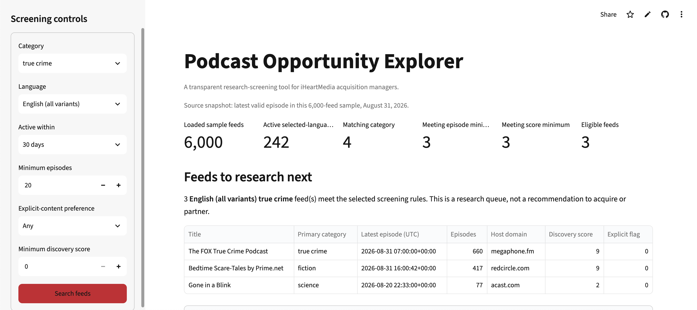
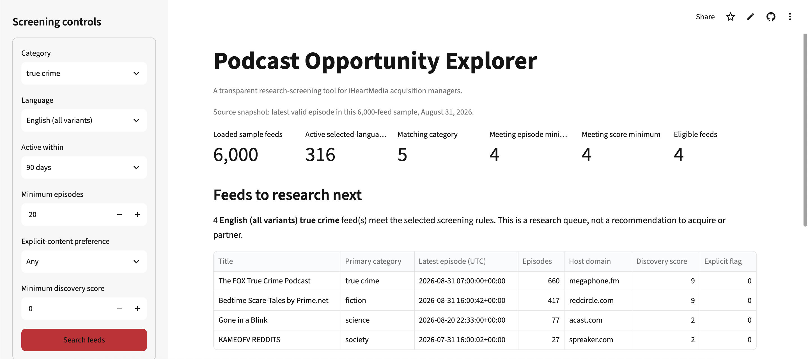

# Bella’s crime-podcast research queue

## Bottom line

Bella should use the Podcast Opportunity Explorer only to create an initial research queue. She should not use it to decide which show to acquire or to estimate audience size. A 90-day screen adds one feed to her queue compared with a 30-day screen, but every candidate still needs verified audience analytics and rights and ownership review.

## 1. The person and decision

Bella is an iHeartMedia acquisition manager. When her current research queue is too thin, she decides whether to expand a crime-podcast search from feeds active within 30 days to feeds active within 90 days, and which newly included feeds deserve deeper research. A poor queue could cause iHeartMedia to miss an active, promising show.

## 2. Bella’s real situation and alternatives

Bella currently relies on manual catalog and search tools. She is trying to find more active, promising shows, but she lacks complete audience and rights information. Before any acquisition decision, she needs verified audience analytics plus rights, ownership, or contract review.

[Google Podcasts Manager — Google News Initiative](https://newsinitiative.withgoogle.com/resources/trainings/google-podcasts-manager/) explains that show- and episode-level analytics include plays, minutes played, and engagement measures. This is the kind of additional audience information Bella needs. [Apple Podcasts for Creators’ ownership-transfer guidance](https://podcasters.apple.com/support/839-transfer-ownership-of-a-podcast) describes an ownership-verification process. [Spotify for Creators’ rights guidance](https://creators.spotify.com/resources/copyright-creator-education) explains that rights claims can restrict or remove episodes and that Spotify cannot grant rights to someone else’s content.

## 3. The app in use

The live app is [Podcast Opportunity Explorer](https://dso576-project-podcast-index.streamlit.app/). Bella selected True Crime, English (all variants), at least 20 episodes, any explicit-content preference, and a minimum discovery score of 0.

With a 30-day activity window, the app returned 3 eligible feeds.

With the same settings and a 90-day activity window, it returned 4 eligible feeds.

## 4. Reading the result for Bella’s decision

The wider window adds one feed to Bella’s research queue. That can help her find another candidate for deeper research, but it is not evidence to acquire that show. The app’s active definition is relative to the August 31, 2026 source snapshot, not necessarily active today.

The app uses a 6,000-feed course sample rather than the full Podcast Index catalog, so promising active feeds may be absent. Each row is a crawled podcast feed, not necessarily a unique show. The app does not show a show’s actual audience, and its discovery score is not an audience measure, acquisition value, ownership, or rights evidence. Bella should wait for verified audience analytics before deciding which candidate is strongest.

## 5. Verdict

Bella is better off using the app to make an initial research queue and then following it with manual catalog/search work, verified audience analytics, and rights and ownership review. The app already makes this boundary clear: it calls the result a research queue rather than an acquisition recommendation and states its limits on audience, ownership, rights, and acquisition value.
