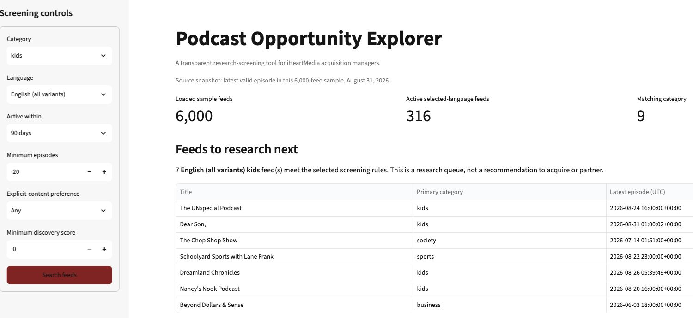
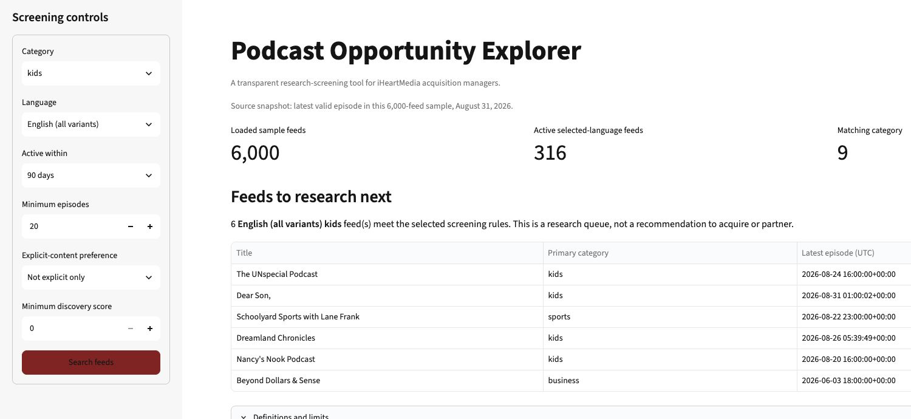

# Daniel: Does "not explicit" mean suitable for children?

Kellen Downey | DSO 576, Module 11 | November 8, 2026

## 1. The person and the decision

Daniel Reyes is a hypothetical content-acquisition researcher at iHeartMedia. He is preparing a research list for a possible English-language listening slate for children ages 6-9. He must decide which feeds deserve child-focused editorial review, and whether selecting **Not explicit only** makes that list suitable for this purpose. His name, assignment, age range, and screening thresholds are case assumptions, not verified iHeartMedia policies or an interview with an employee.

This is a plausible business need: iHeartMedia's announcement of *Adventures of Curiosity Cove* describes a children's podcast distributed by iHeartPodcasts and intended for children and parents listening together [K1]. However, being in a children's category is not enough. Apple distinguishes programming aimed at children from Parenting content aimed at adults, and recommends stating the intended age range in a show's description [K2]. Those distinctions matter more to Daniel than the number of results alone.

Without this app, Daniel could build a spreadsheet from directory searches, curated recommendations, publisher descriptions, and listening to episodes. Common Sense Media's family-podcast list provides age recommendations and editorial summaries [K4]. That is a useful alternative for age-related research, though it does not establish that a show's rights are available. This is a proposed workflow supported by the available tools, not a claim about iHeartMedia's internal process.

## 2. What the live app returned

I compared two searches on the [public Podcast Opportunity Explorer](https://dso576-project-podcast-index.streamlit.app/). Both used **kids**, **English (all variants)**, **90 days**, **20 minimum episodes**, and **minimum discovery score 0**. I changed only the explicit-content preference. Figures 1 and 2 show the live site with these selections visible; they are not screenshots of a local copy.

| Displayed funnel measure | Any | Not explicit only |
| --- | ---: | ---: |
| Loaded sample feeds | 6,000 | 6,000 |
| Active selected-language feeds | 316 | 316 |
| Matching category | 9 | 9 |
| Meeting episode minimum | 7 | 6 |
| Meeting score minimum | 7 | 6 |
| Eligible feeds | 7 | 6 |

The **Not explicit only** search removes *The Chop Shop Show*, whose source explicit flag is 1. The other six feeds have flag 0. This is a reduction of one out of seven initially eligible feeds, or 14.3%; it is not a measured improvement in child suitability. No age-suitability outcome was collected.

The six remaining feeds, in the app's order, are:

| Feed | Episodes | Discovery score | What the source description supports |
| --- | ---: | ---: | --- |
| The UNspecial Podcast | 91 | 8 | Support and conversations aimed at parents raising children with special needs. |
| Dear Son, | 218 | 7 | Fatherhood and relationships between generations of fathers. |
| Schoolyard Sports with Lane Frank | 272 | 5 | Sports discussion; no verified suitability for ages 6-9. |
| Dreamland Chronicles | 72 | 1 | Bedtime stories described as being for children. |
| Nancy's Nook Podcast | 36 | 1 | Personal life stories aimed at supporting women. |
| Beyond Dollars & Sense | 165 | 0 | Money and life topics, including a Kids & Money series. |

The descriptions above are paraphrases of the bundled CSV, not new listening reviews or verified current publisher statements [K5]. They are not displayed in the current app table. In particular, the highest-ranked result addresses parents, while a lower-scored result describes children's bedtime stories. That is concrete evidence against interpreting the ranking as age suitability.

## 3. Reading the result for Daniel's decision

**Does the number measure what he cares about?** Six is the count of feeds passing the selected metadata rules. Daniel needs a count of shows appropriate for a particular child audience. The two measures are different. This is **kind 3 in handout 11.5: a stand-in instead of the real thing**. Neither the `kids` category nor explicit flag 0 measures developmental fit, educational value, sensitive themes, or a specific age range. Apple's documentation also distinguishes show-level and episode-level explicit labels and notes that incorrectly unlabeled episodes may later be marked explicit [K3]. I therefore treat the flag as source metadata, not an independent content review.

**Who is in the rows, and who is not?** The app loads a 6,000-row course sample. A row is a crawled feed, not necessarily a unique show. For this search, it keeps valid episode dates in the 90-day interval ending **August 31, 2026, 23:21:02 UTC**, language tags beginning with `en`, and a `kids` match in category fields 1-8. It then applies the episode, explicit, and score rules and retains the first qualifying row per nonblank Podcast GUID. Blank GUIDs remain. The six results have six distinct nonblank GUIDs, so deduplication does not change this comparison.

Feeds outside the sample, with no valid latest-episode date, below 20 episodes, or otherwise outside the selected rules cannot appear. The 20-episode threshold favors longer histories and could omit a strong new children's show; it is Daniel's provisional workload screen, not evidence of quality. The sampling method's representativeness has not been established, so 6/6,000 is not the share of the podcast market suitable for children. Across the input file, 312 rows have missing/zero latest-episode timestamps and cannot pass activity screening [K5].

**What outside the data matters?** Daniel still needs current publisher information, a stated age range, review of actual episodes and advertising, audience evidence, and confirmation of ownership and available rights. The sample's activity window is June 2 through August 31 at the exact UTC times recorded in the audit; it does not verify recent publishing as of this November review. Nothing here confirms present availability or a right to license a show. A hosting domain is not proof of ownership.

**Does the app improve on the alternatives?** It produces an inspectable, repeatable list of six instead of seven feeds under fixed rules, which is useful for organizing research within this sample. It does not replace an age-reviewed directory, publisher checks, or editorial listening. Common Sense Media supplies age guidance that this app lacks [K4]. No timed workflow comparison was performed, so I do not claim that the app is faster or produces a better child-facing slate than those alternatives.

## 4. Independent check and a misleading label

The attached `check_kellen_case.py` reads the CSV using Python's standard-library `csv` module and loops. It does not import `app.py` or reuse its pandas filtering. It reproduces both live funnel sequences and the complete ordered list of feed titles. It also separates the episode and explicit stages:

| Independently calculated stage | Any | Not explicit only |
| --- | ---: | ---: |
| After episode minimum alone | 7 | 7 |
| After explicit-content preference | 7 | 6 |
| After score rule and GUID deduplication | 7 | 6 |

The app currently applies the explicit filter before calculating the card labeled **Meeting episode minimum**. That is why the card falls from 7 to 6 even though the episode threshold is unchanged. The six-feed final result is correct for the implemented rules; the intermediate label attributes the exclusion to the wrong step. The independent result, settings, source hashes, IDs, and descriptions are saved in `kellen-case-audit.json`.

Run from the repository root: `uv run python check_kellen_case.py`. This verifies these sample calculations against the November 8 observations. It does not validate other settings, current publisher facts, age suitability, or every aspect of the deployed code.

## 5. Verdict and change requests

**Break the interpretation that this is a child-suitable shortlist; retain the app as a preliminary research screen.** Daniel should begin by checking *Dreamland Chronicles*, because its source description explicitly mentions children's bedtime stories, rather than automatically starting with the highest discovery score. That is a research priority, not an endorsement: the age range, current episodes, audience, and rights still need verification. The parent-oriented descriptions give him a reason to separate those feeds from a child-directed slate; they do not establish that the shows are inappropriate in every context.

I would not approve any feed for the slate from this output alone. I would combine the app's reproducible filters with age-reviewed recommendations, publisher information, and editorial review. The case supports two general improvements, recorded in `change-requests.md`:

- **CR-09: Separate the episode and explicit funnel stages.** Keep an episode-only count, then show a distinct count after the explicit preference. For this case the counts must be 7 then 6 for Not explicit only, and 7 then 7 for Any. Keep the same final feeds and order.
- **CR-10: Explain explicit metadata beside the control and flag.** State that 0 means not marked explicit in the source, not independently reviewed or certified for children. Show the meanings of 0, 1, and missing/unknown values without assigning an age rating or changing eligibility. The warning should apply to every category.

These changes help other users who need to understand exclusions or content labels. Existing CR-07 and CR-08 would also help Daniel inspect category matches and descriptions. This case does not claim that any of these requests have been implemented.

## Sources and evidence

Public sources were opened on November 8, 2026. The persona and research priorities are my case assumptions and judgments; source-supported facts and observed results are identified above.

- **[K1] iHeartMedia.** [The Black Effect Podcast Network expands into Kids & Family with Adventures of Curiosity Cove](https://www.iheartmedia.com/pressrelease/iheartmedia-and-charlamagne-tha-gods-black-effect-podcast-network-expands-kids-family-genre). Establishes a real children's-content partnership context.
- **[K2] Apple Podcasts for Creators.** [Apple Podcasts: Kids & Family](https://podcasters.apple.com/support/5325-kids-family). Distinguishes child-focused and parent-focused categories and discusses intended age ranges.
- **[K3] Apple Podcasts for Creators.** [Explicit content on Apple Podcasts](https://podcasters.apple.com/support/5440-explicit-content). Explains source-supplied show/episode flags and corrections to unlabeled explicit content.
- **[K4] Common Sense Media.** [Great Podcasts to Listen to as a Family](https://www.commonsensemedia.org/lists/great-podcasts-to-listen-to-as-a-family). A directly inspected alternative with age recommendations and editorial descriptions.
- **[K5] Team repository evidence.** [app.py](https://github.com/JoanneY416/DSO576-project/blob/32315afa09b0917a426c2e2987044a0450bec442/app.py) and [podcasts_sample.csv](https://github.com/JoanneY416/DSO576-project/blob/32315afa09b0917a426c2e2987044a0450bec442/data/podcasts_sample.csv), base commit `32315af`; the accompanying independent audit and live screenshots. Live counts and displayed order matched these two cases, which does not establish parity for every feature.

## Live-app screenshots

The figures are direct crops of the live browser viewport, retaining every selected control, the result summary, and the feed-title list. Full-width originals are included in `screenshots/` for the remaining columns and funnel cards. No values were recreated or edited.

