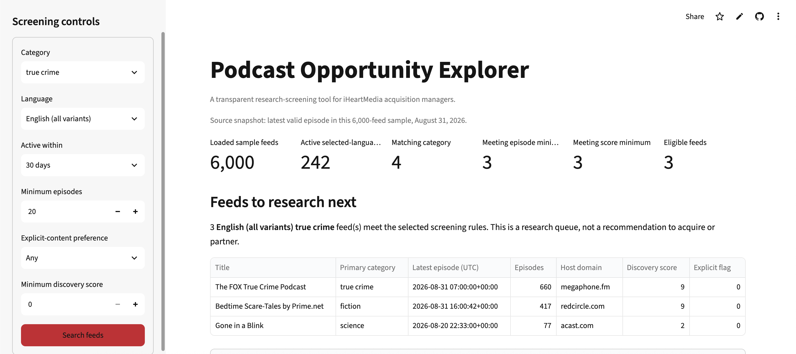
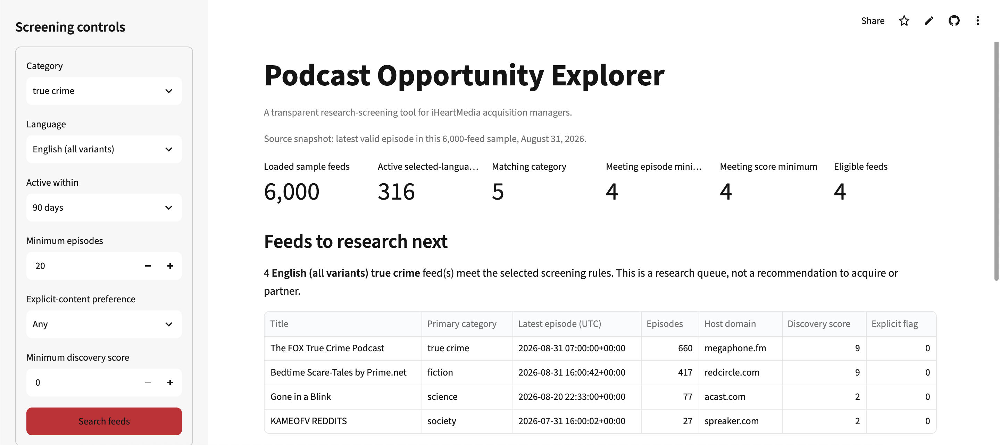
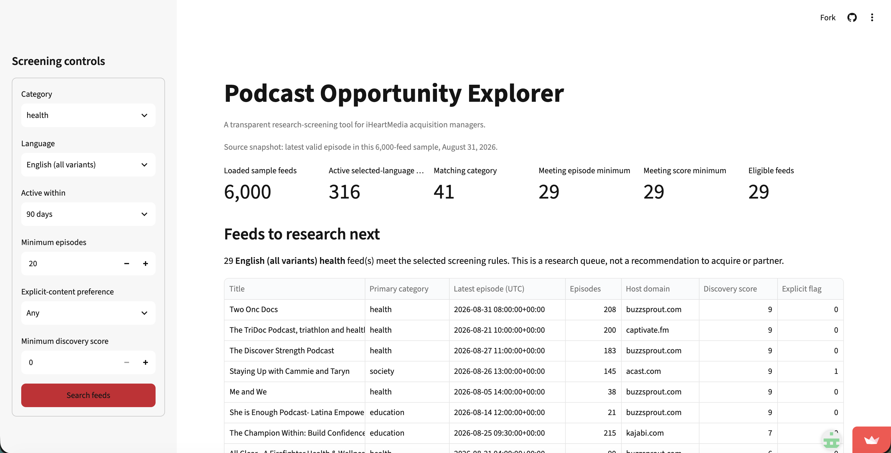

# Podcast Opportunity Explorer validation

Podcast Opportunity Explorer helps iHeartMedia content-acquisition managers make an initial research queue of podcast feeds to investigate. The app screens a 6,000-row Podcast Index course sample using category, language, activity window, episode history, explicit-content preference, and a discovery-score threshold. It supports research prioritization, not an acquisition decision: the data do not measure audience, rights, ownership, revenue, brand safety, or commercial fit.

## 1. Design

The implemented app serves an iHeartMedia acquisition manager whose queue is too thin and who needs candidates for deeper research. The sidebar makes the screening choices visible: category and language focus the search, an activity window distinguishes recent publishing from older feeds, a minimum episode count screens out very short histories, and explicit-content and discovery-score controls make the queue reviewable rather than opaque. The app shows the attrition at each stage and the resulting feed table so a manager can see how a choice changes the queue.

The design deliberately does not rank feeds as acquisition targets or predict commercial success. Its discovery score is a Podcast Index signal, not audience size, downloads, revenue, ownership, rights, brand safety, or acquisition value. The app labels its output a research queue and states that every candidate needs audience, rights, ownership, editorial, commercial, and brand-safety review.

This boundary reflects the real follow-up information a manager needs. [Google Podcasts Manager](https://newsinitiative.withgoogle.com/resources/trainings/google-podcasts-manager/) describes show- and episode-level analytics such as plays and engagement. [Apple Podcasts for Creators](https://podcasters.apple.com/support/839-transfer-ownership-of-a-podcast) describes ownership verification in a podcast-transfer process. [Spotify for Creators](https://creators.spotify.com/resources/copyright-creator-education) explains that rights claims can restrict or remove episodes. Those sources support keeping audience and rights review outside this feed-metadata screen.

The team considered treating the larger project vision as a Riverside localization workspace, but that workspace is not implemented in the deployed app. It is therefore not presented as an app feature or a user case in this validation.

## 2. Cases

### Bella: crime-podcast research queue

Bella is an iHeartMedia acquisition manager. When her current research queue is too thin, she decides whether to widen a True Crime, English-language screen from 30 days to 90 days and which newly included feeds deserve deeper research. Her goal is to find more active, promising shows. She currently relies on manual catalog/search work and needs verified audience analytics plus rights, ownership, or contract review before an acquisition decision.

With the same settings—True Crime; English (all variants); at least 20 episodes; any explicit-content preference; and a minimum discovery score of 0—the live app returned 3 eligible feeds at 30 days and 4 at 90 days.





The 90-day screen adds one feed to Bella's research queue, not evidence to acquire it. The app's active definition is relative to the August 31, 2026 source snapshot, not necessarily active today. Its 6,000-feed sample may omit promising feeds, and each row is a crawled feed rather than necessarily a unique show. Because the result does not show actual audience, Bella waits for verified audience analytics before deciding which candidate is strongest. She is better off using the app only to create an initial queue, then following with manual catalog/search work and audience, rights, and ownership review.

### Sophie: wellness-brand podcast outreach

Sophie Chen is an influencer-partnerships manager at a PR agency representing a wellness brand that plans an early-2027 launch. She must decide which health and wellness podcasts to research for a possible guest appearance by the brand's founder. A poor shortlist wastes outreach time and campaign resources on inactive shows or shows that are unsuitable for the brand's intended audience.

Sophie normally researches a podcast's content, audience, format, and previous guests before pitching it, as [Curzon PR's pitching guidance](https://curzonpr.com/theprinsider/how-to-pitch-to-podcasts-a-playbook-for-pr-firms/) recommends. She could search directories such as Listen Notes and use [Rephonic's podcast-search tool](https://rephonic.com/blog/podcast-search-tool/) to investigate estimated audience, listener demographics, and prior guests. Those alternatives remain necessary: the app's feed metadata cannot establish audience fit, listener engagement, or whether a show accepts outside guests.

In the live app, Sophie selected Health; English (all variants); active within 90 days; at least 20 episodes; any explicit-content preference; and a minimum discovery score of 0.



The app screened the 6,000-feed sample and reported 316 active English-language feeds, 41 matching the Health category, and 29 eligible feeds after the remaining rules. That gives Sophie a manageable initial research shortlist, but it is a count of feeds meeting metadata rules—not a count of podcasts suitable for the campaign. The app's activity window ends at the sample's August 31, 2026 snapshot, rather than today; shows outside the sample or below the episode threshold are excluded. Each row is a crawled feed, not necessarily a unique show, and repeated nonblank GUIDs are deduplicated while blank GUIDs remain.

The 29 feeds are therefore a proxy for partnership opportunities, not proof of them. In particular, the discovery score is not audience size, downloads, engagement, revenue, or partnership suitability. Sophie still needs to check audience demographics and interests, guest format and availability, campaign cost, and scheduling by using external research tools, podcast websites, and direct host contact. The 6,000-row sample contains no guest metadata, episode-level descriptions, or transcripts; although 5,470 feeds have show descriptions, keyword matching would not reliably determine whether they accept guest interviews.

**Verdict — prove.** Sophie is better off using the app to create a structured, reproducible first-pass shortlist than relying only on manual directory searches. She must not use it alone to decide which podcasts to contact or partner with. Given the available data, retaining the transparent screening rules and stated limits is preferable to inventing an unreliable guest-interview indicator; Rephonic and direct research remain the next steps for any shortlisted feed.

### Remaining team cases — required before submission

Add every other team member's completed final case here. The cases together must cover the implemented app's main users and include at least one difficult case. Each case needs a real person, a decision, sources about how that person decides, a live-app screenshot with selections visible, interpretation of the result and data limits, and a verdict.

## 3. Numbers

### Definitions

The app loads 6,000 rows from `data/podcasts_sample.csv`; one row is a crawled podcast feed. It treats `newestItemPubdate` of zero as missing, converts the remaining Unix timestamps to UTC, and uses the latest valid timestamp in the sample as the snapshot. For the live Bella screen, an eligible feed has all of the following properties:

1. Its language begins with `en`.
2. Its latest nonzero episode timestamp is within the selected 30- or 90-day window ending at the sample snapshot.
3. `true crime` appears in any of `category1` through `category8`.
4. Its `episodeCount` is at least 20.
5. Its `popularityScore` is at least 0.
6. It is not a repeated nonblank `podcastGuid`; rows with blank GUIDs remain.

The live app reported 3 eligible feeds at 30 days and 4 at 90 days, with the other Bella settings unchanged. The independent `check_numbers.py` script reads the CSV directly with Python's `csv` module, recreates those definitions without importing `app.py`, and printed the same two counts on November 6, 2026:

```text
cd DSO576-project
uv run python check_numbers.py
```

```text
Rows loaded: 6000
Snapshot: 2026-08-31
Eligible True Crime English feeds, 30 days: 3
Eligible True Crime English feeds, 90 days: 4
```

If a future rerun differs from the live app, the team should document and resolve the difference rather than claiming agreement.

## 4. Tests

The current automated test suite contains one focused regression test, `test_screening_keeps_blank_guid_and_removes_repeat_guid`. It constructs a three-row example by hand: two rows share a nonblank GUID and one has a blank GUID. It verifies that the app keeps the first nonblank-GUID row, removes the repeated-GUID row, and retains the blank-GUID row. This protects a consequential property of the feed queue: a repeated identified feed should not be counted twice, while a feed without an identifier should not be discarded merely because it cannot be deduplicated safely.

The team ran the suite on November 6, 2026 with:

```text
cd DSO576-project
uv run pytest
```

Result: `1 passed in 1.85s`.

### Tests still needed before submission

The current test is not yet enough to claim broad protection. Add and run tests for the activity-window boundary, zero/missing episode timestamps, English-variant matching, category matching outside `category1`, minimum episode and discovery-score boundaries, and an empty-result screen. Replace this subsection with the actual added tests and their results before exporting `validation.pdf`.
