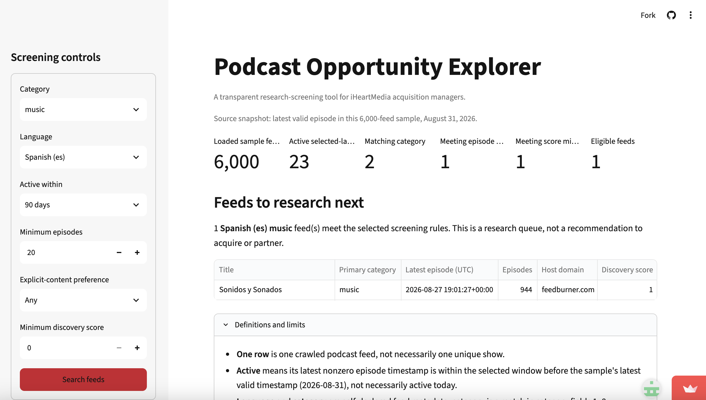
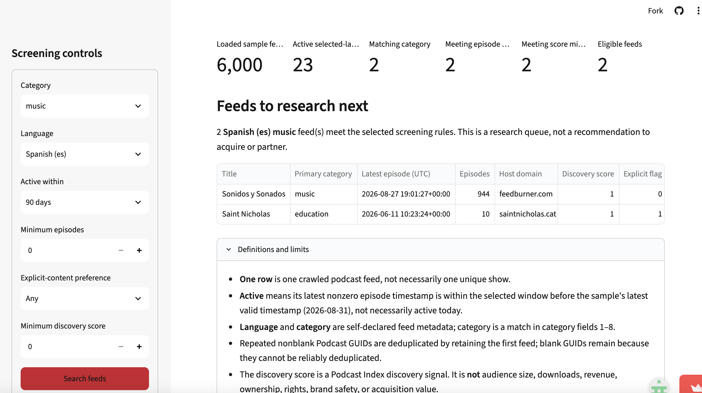
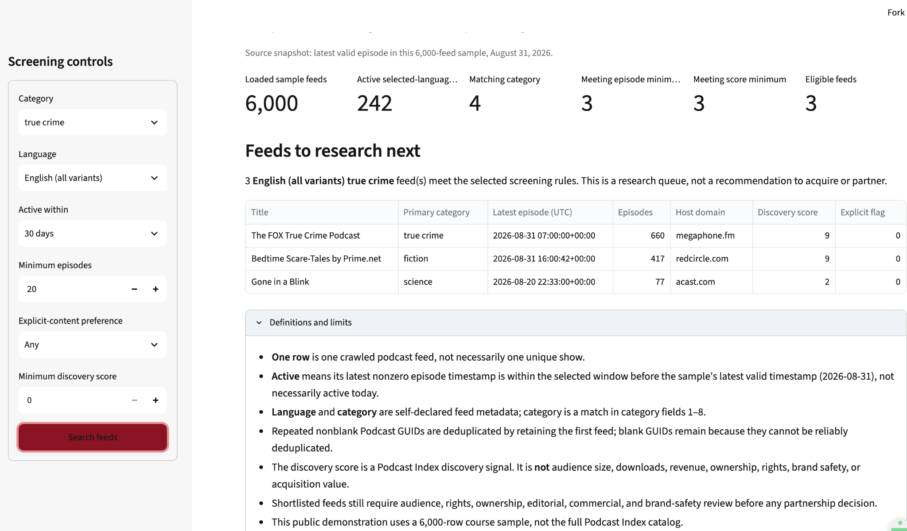
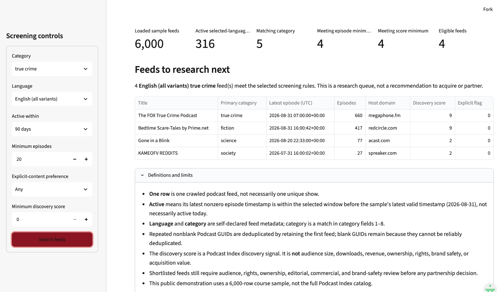

# Podcast Opportunity Explorer validation

Podcast Opportunity Explorer helps iHeartMedia content-acquisition managers make an initial research queue of podcast feeds to investigate. The app screens a 6,000-row Podcast Index course sample using category, language, activity window, episode history, explicit-content preference, and a discovery-score threshold. It supports research prioritization, not an acquisition decision: the data do not measure audience, rights, ownership, revenue, brand safety, or commercial fit.

## 1. Design

The implemented app serves an iHeartMedia acquisition manager whose queue is too thin and who needs candidates for deeper research. The sidebar makes the screening choices visible: category and language focus the search, an activity window distinguishes recent publishing from older feeds, a minimum episode count screens out very short histories, and explicit-content and discovery-score controls make the queue reviewable rather than opaque. The app shows the attrition at each stage and the resulting feed table so a manager can see how a choice changes the queue.

The design deliberately does not rank feeds as acquisition targets or predict commercial success. Its discovery score is a Podcast Index signal, not audience size, downloads, revenue, ownership, rights, brand safety, or acquisition value. The app labels its output a research queue and states that every candidate needs audience, rights, ownership, editorial, commercial, and brand-safety review.

This boundary reflects the real follow-up information a manager needs. [Google Podcasts Manager](https://newsinitiative.withgoogle.com/resources/trainings/google-podcasts-manager/) describes show- and episode-level analytics such as plays and engagement. [Apple Podcasts for Creators](https://podcasters.apple.com/support/839-transfer-ownership-of-a-podcast) describes ownership verification in a podcast-transfer process. [Spotify for Creators](https://creators.spotify.com/resources/copyright-creator-education) explains that rights claims can restrict or remove episodes. Those sources support keeping audience and rights review outside this feed-metadata screen.

The team considered treating the larger project vision as a Riverside localization workspace, but that workspace is not implemented in the deployed app. It is therefore not presented as an app feature or a user case in this validation.

## 2. Cases

### Bella: crime-podcast research queue

Bella is an iHeartMedia acquisition manager. When her current research queue is too thin, she decides whether to widen a True Crime, English-language screen from 30 days to 90 days and which newly included feeds deserve deeper research. Her goal is to find more active, promising shows. She currently relies on manual catalog/search work and needs verified audience analytics plus rights, ownership, or contract review before an acquisition decision.

With the same settings—True Crime; English (all variants); at least 20 episodes; any explicit-content preference; and a minimum discovery score of 0—the live app returned 3 eligible feeds at 30 days and 4 at 90 days.


The 90-day screen adds one feed to Bella's research queue, not evidence to acquire it. The app's active definition is relative to the August 31, 2026 source snapshot, not necessarily active today. Its 6,000-feed sample may omit promising feeds, and each row is a crawled feed rather than necessarily a unique show. Because the result does not show actual audience, Bella waits for verified audience analytics before deciding which candidate is strongest. She is better off using the app only to create an initial queue, then following with manual catalog/search work and audience, rights, and ownership review.

### Sophie: wellness-brand podcast outreach

Sophie Chen is an influencer-partnerships manager at a PR agency representing a wellness brand that plans an early-2027 launch. She must decide which health and wellness podcasts to research for a possible guest appearance by the brand's founder. A poor shortlist wastes outreach time and campaign resources on inactive shows or shows that are unsuitable for the brand's intended audience.

Sophie normally researches a podcast's content, audience, format, and previous guests before pitching it, as [Curzon PR's pitching guidance](https://curzonpr.com/theprinsider/how-to-pitch-to-podcasts-a-playbook-for-pr-firms/) recommends. She could search directories such as Listen Notes and use [Rephonic's podcast-search tool](https://rephonic.com/blog/podcast-search-tool/) to investigate estimated audience, listener demographics, and prior guests. Those alternatives remain necessary: the app's feed metadata cannot establish audience fit, listener engagement, or whether a show accepts outside guests.

In the live app, Sophie selected Health; English (all variants); active within 90 days; at least 20 episodes; any explicit-content preference; and a minimum discovery score of 0.


The app screened the 6,000-feed sample and reported 316 active English-language feeds, 41 matching the Health category, and 29 eligible feeds after the remaining rules. That gives Sophie a manageable initial research shortlist, but it is a count of feeds meeting metadata rules—not a count of podcasts suitable for the campaign. The app's activity window ends at the sample's August 31, 2026 snapshot, rather than today; shows outside the sample or below the episode threshold are excluded. Each row is a crawled feed, not necessarily a unique show, and repeated nonblank GUIDs are deduplicated while blank GUIDs remain.

The 29 feeds are therefore a proxy for partnership opportunities, not proof of them. In particular, the discovery score is not audience size, downloads, engagement, revenue, or partnership suitability. Sophie still needs to check audience demographics and interests, guest format and availability, campaign cost, and scheduling by using external research tools, podcast websites, and direct host contact. The 6,000-row sample contains no guest metadata, episode-level descriptions, or transcripts; although 5,470 feeds have show descriptions, keyword matching would not reliably determine whether they accept guest interviews.

**Verdict — prove.** Sophie is better off using the app to create a structured, reproducible first-pass shortlist than relying only on manual directory searches. She must not use it alone to decide which podcasts to contact or partner with. Given the available data, retaining the transparent screening rules and stated limits is preferable to inventing an unreliable guest-interview indicator; Rephonic and direct research remain the next steps for any shortlisted feed.

### Sofía: Spanish-language nostalgic music and cover versions

Use Podcast Opportunity Explorer to build an initial research list, then read descriptions to check for nostalgic music and cover versions. Set the episode minimum to 0 rather than excluding candidates through an unexamined default. Sonidos y Sonados deserves further investigation, but the results do not justify a partnership decision or establish that the app is more helpful than searching Spotify directly.

#### 1. The person and the decision

Sofía is a fictional Spanish-language music content development manager at iHeartMedia. When she identifies a need to add more programming featuring nostalgic music and cover versions to the existing Spanish-language catalog, she looks for potential podcast partners. Her decision is which shows deserve further investigation and contact. If she ultimately selects and promotes shows that do not match that theme, listeners expecting those features could be disappointed and leave. This is a risk assumed for the case, not an observed audience loss.

Her name, specific role, and assignment are scenario assumptions rather than verified internal company arrangements.

#### 2. Her real situation and alternatives

iHeartMedia already has experience with music history content. Its My Cultura launch announcement describes El Flow as exploring reggaeton history, so this case does not assume that the company has no such programming. Another announcement describes Latino USA joining My Cultura for podcast distribution. This is an example of bringing an existing show into the network through a partnership, rather than evidence of an acquisition.

- **Publisher: iHeartMedia.** [iHeartMedia To Launch New Podcast Network ‘My Cultura’ Elevating Latinx Voices and Stories](https://www.iheartmedia.com/press/iheartmedia-launch-new-podcast-network-my-cultura-elevating-latinx-voices-and-stories). Supporting excerpt: “The show takes a historical look at the rise of Reggaeton”.
- **Publisher: iHeartMedia.** [Futuro Media’s “Latino USA” Podcast Joins iHeartMedia’s My Cultura Podcast Network](https://www.iheartmedia.com/press/futuro-medias-latino-usa-podcast-joins-iheartmedias-my-cultura-podcast-network). Supporting excerpt: “will now distribute the podcast version of the show”.

Without our app, the workflow I assume for Sofía is to search Spotify for Spanish-language podcasts featuring nostalgic music and cover versions, read descriptions, and listen to episodes. This is a scenario assumption, not a verified company practice. I have not completed an efficiency comparison between these methods.

Audience interest is a priority in this case: Sofía needs to know whether listeners are interested in nostalgic tracks and cover versions, rather than assuming that a music category establishes demand. Spotify's guidance recommends audience research through surveys, polls, and conversations with creators. **Publisher: Spotify for Creators.** [How to discover and reach your podcast’s target audience](https://creators.spotify.com/resources/podcast-target-audience). Supporting excerpt: “You can ask them questions about themselves, about particular episodes, and what kind of content they like”. This supports audience research as a possible follow-up method; it does not verify iHeartMedia's internal process or this candidate's audience interests.

#### 3. The app in use

**Public app:** [Podcast Opportunity Explorer](https://dso576-project-podcast-index.streamlit.app/).

The initial settings were Category = music; Language = Spanish (es); Active within = 90 days; Minimum episodes = 20; Explicit-content preference = Any; Minimum discovery score = 0. The screenshot shows a sample of 6,000 feeds and a snapshot date of August 31, 2026. There are 23 active selected-language feeds, 2 matching the category, and 1 remaining after the episode minimum. The candidate, Sonidos y Sonados, has 944 episodes and a discovery score of 1. The discovery score is a Podcast Index discovery signal, not a measure of audience size or partnership value.



The 20-episode minimum was an app default I used, not Sofía’s requirement. Changing only that minimum to 0, while holding the other visible settings constant, produces 2 candidates. The additional candidate, Saint Nicholas, has 10 episodes. I chose to remove the episode minimum and review descriptions for thematic fit. I have not established whether Saint Nicholas fits the intended theme.



#### 4. Reading the results for her decision

**Does the number measure what she cares about?** The Spanish-language and music filters support initial screening, but they do not establish that a show features nostalgic music or cover versions. I consider reading descriptions necessary.

The candidate's [Spotify show page](https://open.spotify.com/show/033ilC6MaZGFF7t7MKojeo) provides a place to investigate the program. Spotify's description text could not be retrieved during this review, so I verified the following episode descriptions on the show's own website (English summaries):

- **June 4, 2026 — Publisher: Sonidos y Sonados.** The [episode description on the show's website](https://sonidosysonados.com/) lists nostalgic tracks featuring Magma and Cai and original/cover pairings involving Lole y Manuel/Medina Azahara and Leonard Cohen/Enrique Morente y Lagartija Nick.
- **October 22, 2026 — Publisher: Sonidos y Sonados.** The [episode description on the show's website](https://sonidosysonados.com/) identifies regular sections, including original/cover pairings involving Chris Kenner/Wilson Pickett and Barrabas/Herbie Mann, and nostalgic selections featuring James Brown and Cosmosoul.

These descriptions support my judgment that the show repeatedly covers Sofía's intended themes and deserves further investigation. The October episode is follow-up content evidence obtained after the app's August snapshot, not information available in that snapshot. I have not listened to the episodes, so this does not establish overall quality, audience interest, or partnership value.

**Who is in the rows, and who is not?** The current repository’s app.py reads podcasts_sample.csv. One row represents a crawled feed, not necessarily a unique show. The program applies valid-date, language, category, episode-count, explicit-content, and score filters. It then retains the first occurrence of repeated nonblank Podcast GUIDs; blank GUIDs remain. The music filter checks all eight category fields, so Saint Nicholas displaying education as its primary category does not by itself demonstrate a filtering error.

The es language selection uses an exact match rather than automatically including every regional Spanish tag; its actual effect has not been checked. Activity is measured relative to the sample’s latest valid timestamp, not necessarily today. Feeds outside the sample, those failing the selected conditions, and those missing valid dates are absent. I have not verified that the live deployment exactly matches the current repository version.

**What outside the data matters?** Sofía needs to know whether the candidate's listeners share her intended audience's interest in nostalgic music and cover versions. Episode descriptions establish thematic fit, but they do not establish listeners' interests. Spotify's audience-research guidance above describes ways to ask listeners what content they enjoy. Such feedback would be evidence to seek in further investigation, not evidence collected in this case. The app table provides no direct evidence of audience-interest fit, and I have not obtained listener feedback for either audience. The risk that mismatched programming could disappoint listeners remains a scenario assumption.

**What could she wrongly conclude?** One returned candidate does not mean that the entire market contains only one relevant show. Lowering the episode minimum produces a second candidate, demonstrating that the count depends on inclusion rules. The data are also a sample. This illustrates kind 2 in handout 11.5: which rows belong. Sofía should not treat this shortlist as a reason to stop looking elsewhere.

#### 5. The verdict and change request

The app can provide an initial research list. Descriptions are still needed to assess thematic fit, and the screening results should not determine a partnership decision. Sonidos y Sonados is worth further investigation. I do not yet have sufficient comparative evidence to conclude that the app helps Sofía more than searching Spotify directly.

My requested improvement is **CR-08: add source-provided show descriptions and show-page or listening links to Podcast Opportunity Explorer’s results**. Both the saved screenshot and the current code’s result table lack this information. Adding it would help me check candidates’ themes and would also serve users researching other topics. Expandable descriptions could preserve the existing filters and ranking. Missing information should be labeled explicitly rather than replaced with generated descriptions. Any actual time savings still need to be tested.

This proposed request is recorded as **CR-08** in the shared change-request log. The screenshot comparison and episode descriptions support the app’s initial-screening role and this improvement, rather than establishing acquisition value or complete market coverage.

### Maya: true-crime research shortlist (Yifei Gan)

Yifei Gan | DSO 576 | Individual Case

#### 1 The person and the decision

Maya Chen is a hypothetical podcast acquisitions researcher at iHeartMedia. She needs to choose English-language true crime feeds for an initial review. She has limited research time, so she wants to see whether a 30-day or 90-day activity filter gives her a more useful shortlist. This is a research decision, not a decision to buy a podcast.

#### 2 Her situation and alternatives

iHeartMedia’s partnership with Global includes licensing, distribution and advertising representation [1]. This shows why Maya needs to check more than a show’s title before considering a partnership. Acast describes Podcast Index as an open database that creators can submit their shows to [2]. It is useful for discovery, but a listing does not prove commercial availability.

Maya could search podcast directories, read publisher websites and listen to recent episodes, then organize the results in a spreadsheet. The App helps her apply the same screening rules to its sample. She still needs those other sources to check ownership, current activity and content quality.

#### 3 The app in use

Live App: [Podcast Opportunity Explorer](https://dso576-project-podcast-index.streamlit.app/)

I selected true crime, English (all variants), at least 20 episodes, Any explicit-content preference, and a minimum discovery score of 0. I searched with 30 days and then 90 days, keeping the other settings unchanged. These are case choices, not official iHeartMedia requirements.

The 30-day search returned 3 eligible feeds. The 90-day search returned the same 3 plus KAMEOFV REDDITS. Its latest displayed episode was July 31, 2026, with 27 episodes and a discovery score of 2. The screenshots below show both searches.

##### Screenshots of the live app



Figure 1. With the 30-day activity window, 3 feeds meet the screening rules.



Figure 2. With the 90-day window, KAMEOFV REDDITS is added, giving 4 eligible feeds.

#### 4 Reading the result for her decision

**Does the number measure what she needs?** The results help Maya make a research list. They do not show which podcast is the best investment. The App says discovery score is not audience size, revenue or acquisition value, so a score of 9 does not prove a better opportunity than a score of 2.

**Who is included or left out?** The App uses a 6,000-feed course sample, not the full Podcast Index catalog. Each row is a feed, which may not be a unique show. Shows outside the sample or below the 20-episode minimum are excluded. The App also says feeds with blank GUIDs cannot be reliably deduplicated.

**What outside the data matters?** The activity windows end on August 31, 2026, the sample’s reference date. They do not measure activity relative to today. Maya should check current feeds, ownership, available rights and recent content before contacting anyone. Hosting domains and explicit-content flags do not settle those questions.

**What could she wrongly conclude?** She could think the four results are the best currently active true crime acquisition targets. That would confuse sample eligibility with market coverage and commercial suitability. Three results also have primary categories other than true crime. The App matches category fields 1–8, so this does not prove a bug, but the exact matching field is not shown.

#### 5 The verdict and change request

I would start by reviewing the three feeds that appear under both activity windows and keep KAMEOFV REDDITS as a backup. Its exclusion from the 30-day search does not prove it has stopped publishing. The App is useful for narrowing this sample, while directories and publisher checks remain necessary for broader discovery and verification.

I choose break because the category match is difficult to check. My change request is to show the matched category and whether it is primary or secondary for each result. The change should work for every category and should not change which feeds qualify. A simple check is that the same four feeds remain in the 90-day result, with their matching category fields visible. This would make the shortlist easier to explain without treating it as an acquisition recommendation.

##### Sources

[1] iHeartMedia, November 15, 2023. [iHeartMedia and Global Sign Multi-Year Podcast Partnership Deal in the UK, Ireland and USA](https://investors.iheartmedia.com/news/news-details/2023/iHeartMedia-and-Global-Sign-Multi-Year-Podcast-Partnership--Deal-in-the-UK-Ireland-and-USA-2023-hYxAs7n6ad/default.aspx)

[2] Acast Learning Center, April 17, 2026. [What is Podcast Index](https://learn.acast.com/en/articles/8597256-what-is-podcast-index)

### Remaining team cases — required before submission

Add every other team member's completed final case here. The cases together must cover the implemented app's main users and include at least one difficult case. Each case needs a real person, a decision, sources about how that person decides, a live-app screenshot with selections visible, interpretation of the result and data limits, and a verdict.

## 3. Numbers

### Definitions

The app loads 6,000 rows from `data/podcasts_sample.csv`; one row is a crawled podcast feed. It treats `newestItemPubdate` of zero as missing, converts the remaining Unix timestamps to UTC, and uses the latest valid timestamp in the sample as the snapshot. For the live Bella screen, an eligible feed has all of the following properties:

1. Its language begins with `en`.
2. Its latest nonzero episode timestamp is within the selected 30- or 90-day window ending at the sample snapshot.
3. `true crime` appears in any of `category1` through `category8`.
4. Its `episodeCount` is at least 20.
5. Its `popularityScore` is at least 0.
6. It is not a repeated nonblank `podcastGuid`; rows with blank GUIDs remain.

The live app reported 3 eligible feeds at 30 days and 4 at 90 days, with the other Bella settings unchanged. The independent `check_numbers.py` script reads the CSV directly with Python's `csv` module, recreates those definitions without importing `app.py`, and printed the same two counts on November 6, 2026:

```text
cd DSO576-project
uv run python check_numbers.py
```

```text
Rows loaded: 6000
Snapshot: 2026-08-31
Eligible True Crime English feeds, 30 days: 3
Eligible True Crime English feeds, 90 days: 4
```

If a future rerun differs from the live app, the team should document and resolve the difference rather than claiming agreement.

## 4. Tests

The automated suite contains 13 tests. The original regression test, `test_screening_keeps_blank_guid_and_removes_repeat_guid`, constructs a three-row example by hand: two rows share a nonblank GUID and one has a blank GUID. It verifies that the app keeps the first nonblank-GUID row, removes the repeated-GUID row, and retains the blank-GUID row. This protects a consequential property of the feed queue: a repeated identified feed should not be counted twice, while a feed without an identifier should not be discarded merely because it cannot be deduplicated safely.

`test_mvp_validation.py` adds coverage for the activity-window boundary, missing episode dates, a category match in `category8`, language selection including English variants, episode and discovery-score boundaries, explicit-content filtering, missing and malformed numeric values during loading, and the empty-result screen. `validate_current_mvp.py` independently recalculates the funnel counts and ordered results for 10 settings directly from the CSV, including the Bella, Sophie, and Sofía screens. `check_standalone.py` verifies that the app runs from the bundled repository files.

The team ran the verification on November 8, 2026 with:

```text
cd DSO576-project
uv sync --locked
uv run python validate_current_mvp.py
uv run pytest -q test_app.py test_mvp_validation.py
uv run python check_standalone.py
```

Results: dependency installation succeeded; the independent calculations matched the app for all 10 settings; the regression suite reported `13 passed`; and the local Streamlit health and root requests returned HTTP 200. Detailed commands, outputs, and limits are recorded in `mvp-verification.md` and `validation-check-results.json`. These checks validate the bundled application and selected calculation rules, but do not establish public-deployment parity, browser behavior in every environment, source-data accuracy, or the validity of the cases' business judgments.

### Tests still needed before submission

The current test suite provides focused coverage, but does not yet establish broad protection. Before final submission, add and run tests for public-deployment parity, browser behavior across supported environments, source-data/schema changes, and any newly implemented change requests. Record the actual added tests and their results before exporting `validation.pdf`.
